# Awesome ChatGPT Prompts for Pictures of Yourself

A hand-picked gallery of **real ChatGPT prompts for pictures of yourself**, shared by creators on X. Every prompt is written around **your own uploaded photo**, and every entry keeps the **full prompt, verbatim**, the **output image**, and a **link to the original post**.

No generated-by-script prompt lists: each prompt below was posted by a person alongside the picture it made.

> ⚡ **Run any of these with your own photo right now:** open the [ChatGPT prompts for pictures of yourself gallery on Veida](https://veida.ai/prompts/pictures-of-yourself?utm_source=github&utm_medium=readme&utm_campaign=awesome-chatgpt-pictures-of-yourself-prompts), pick a card and press *Make it with my photo* — the prompt drops into the generator and the photo picker opens.

## Contents

- [Headshots & Portraits](#headshots-portraits) (4)
- [Aesthetic Photoshoots](#aesthetic-photoshoots) (5)
- [Funny Pictures of Yourself](#funny-pictures-of-yourself) (3)
- [How to use these prompts](#how-to-use-these-prompts)
- [Contributing](#contributing)

## Headshots & Portraits

### 1. Executive studio headshot, jacket over the shoulder

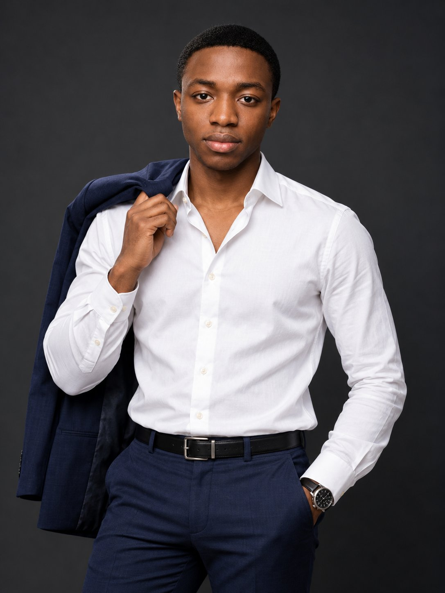

**Model:** GPT Image 2.5 · **By:** [@abs_uiux](https://x.com/abs_uiux) · **Source:** [original post](https://x.com/abs_uiux/status/2106831302682923177)

```text
Use the uploaded photo as the facial identity reference.

Create a premium professional studio portrait of a stylish young adult man standing confidently against a dark charcoal-gray seamless background.

Subject: A handsome young adult man with a clean, very low-cut haircut, sharp natural hairline, defined facial features, and a calm, confident expression. He looks directly into the camera.

Outfit: Crisp fitted white long-sleeve button-down dress shirt with the top two buttons casually open, tucked neatly into tailored dark navy trousers. A dark navy suit jacket is draped naturally over one shoulder, held lightly by one hand near the collar. His other hand rests casually inside his trouser pocket. Add a sophisticated black-and-silver wristwatch.

Pose: Relaxed upright posture, shoulders slightly angled while the face remains toward the camera. One hand holds the jacket over the shoulder while the opposite hand stays in the pocket. Natural, masculine, elegant body language.

Hair: Very short low-cut haircut, evenly trimmed close to the scalp, clean sharp hairline and temple edges, no curls, no high fade, no long hair.

Lighting: Professional studio portrait lighting with a large softbox positioned slightly above and to one side of the subject. Soft highlights across the face and white shirt, subtle shadows defining the jawline and body, gentle rim separation from the dark background.

Camera: Full-frame professional camera, 85mm portrait lens, f/2.8, ISO 100, highly detailed facial features, realistic skin texture, sharp eyes, natural depth of field.

Composition: Vertical 3:4 portrait, framed approximately from the upper thighs upward, subject centered with generous dark negative space around the head and shoulders.

Style: Luxury corporate editorial photography, sophisticated menswear campaign, photorealistic, natural skin texture, realistic fabric folds, clean contrast, subtle cinematic color grading, premium magazine quality, high dynamic range, ultra-detailed, no text, no watermark.
```

[▶ Make it with your photo](https://veida.ai/prompts/pictures-of-yourself?utm_source=github&utm_medium=readme&utm_campaign=awesome-chatgpt-pictures-of-yourself-prompts)

---

### 2. Over-the-shoulder side profile in soft daylight

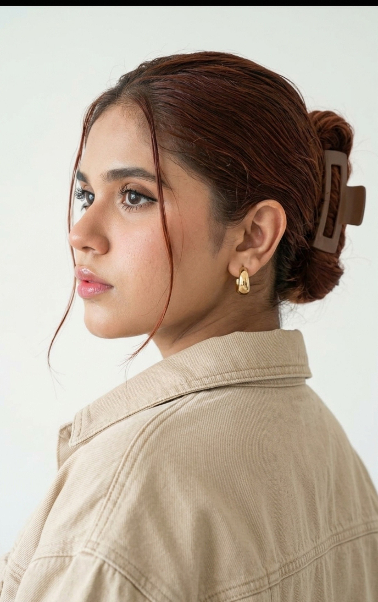

**Model:** not stated · **By:** [@oye_samia](https://x.com/oye_samia) · **Source:** [original post](https://x.com/oye_samia/status/2107343815137017902)

```text
Create a maximally photorealistic portrait, using my uploaded photo as the exact basis for appearance. Keep the face and features 1:1; do not change age or proportions.

The girl is shot from the shoulders up from behind, turned, head rotated to the left, face shown in a clear side profile. Gaze directed to the side, expression calm and confident.

Hair is gathered into a neat low voluminous bun and secured with a large brown claw clip. Two thin loose strands are left framing the face. Keep the hair color as in my original photo.

She wears a loose oversized beige denim jacket with a wide collar. Small chunky gold hoop earrings. Natural makeup: even, lively skin, a light blush, neat brows, defined lashes, naturally glossy lips.

Solid milky-white background. Soft diffused daylight with no harsh shadows. The frame is minimalist and bright, with a Pinterest and lifestyle-fashion aesthetic. Living skin, natural hair and fabric texture, no CGI, plastic retouching, or neural-network look.
```

[▶ Make it with your photo](https://veida.ai/prompts/pictures-of-yourself?utm_source=github&utm_medium=readme&utm_campaign=awesome-chatgpt-pictures-of-yourself-prompts)

---

### 3. Golden-hour rooftop café, white shirt and sneakers

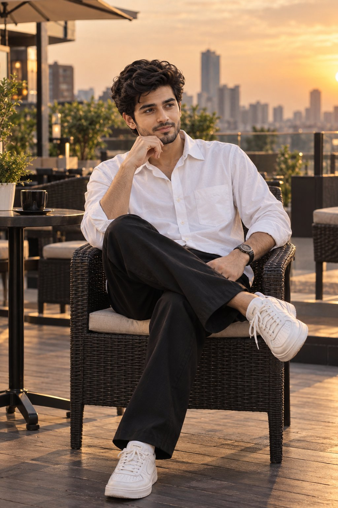

**Model:** not stated · **By:** [@thatguy_ak_](https://x.com/thatguy_ak_) · **Source:** [original post](https://x.com/thatguy_ak_/status/2101480713769869321)

```text
Use the uploaded photo as the primary identity and facial-reference image. Preserve the man’s exact facial identity, facial structure, hairstyle, skin tone, distinctive features, body proportions, and recognizable likeness. Do not replace him with a generic model.

Create an ultra-realistic cinematic full-body photograph of the same young South Asian man sitting casually on a dark woven rattan chair at a sophisticated rooftop café terrace.

He is wearing a crisp oversized white button-down shirt, with the sleeves naturally rolled slightly above the wrists, loose relaxed-fit black trousers, and clean white chunky sneakers. The clothing should have realistic fabric folds, natural draping, and premium contemporary fashion styling.

He is seated in a relaxed cross-legged pose, with one hand resting naturally near his chin while the other rests comfortably on his leg or chair. His posture is effortless and confident. He is looking thoughtfully toward the side, away from the camera, with a calm, natural, subtly contemplative expression.

 Environment

A stylish modern rooftop café terrace with sophisticated urban architecture, dark wood and rattan furniture, subtle greenery, warm architectural details, and a distant city skyline. Keep the environment elegant and uncluttered so the man remains the visual focus.

 Lighting & atmosphere

Use beautiful cinematic golden-hour lighting with soft directional sunlight, gentle highlights along the hair and shoulders, subtle rim lighting, realistic natural shadows, and atmospheric depth. Create a premium lifestyle-fashion photography mood with a warm yet sophisticated cinematic color grade.

 Photography

Full-body composition, eye-level camera perspective, natural proportions, realistic anatomy, detailed skin texture, individual hair strands, authentic fabric texture, realistic sneaker materials, physically accurate shadows and reflections, shallow-to-moderate depth of field, subtle background bokeh, professional editorial photography, high dynamic range, cinematic contrast, photorealistic detail, 8K-quality appearance.

The final image should look like a real photograph taken for a premium contemporary fashion/lifestyle campaign, not an AI-generated image.

Composition: vertical portrait, full body completely visible including both shoes, subject centered slightly off-center, enough negative space around the chair and skyline, balanced framing.

Important identity instruction: The uploaded photo is the source of truth for the subject’s identity. Maintain the same person consistently and accurately.

Avoid: altered facial identity, generic face, excessive retouching, plastic skin, distorted hands, extra fingers, malformed feet, incorrect anatomy, floating limbs, duplicated objects, overly dramatic posing, cartoon/illustration styling, excessive blur, oversaturation, text, logos, or watermarks.
```

[▶ Make it with your photo](https://veida.ai/prompts/pictures-of-yourself?utm_source=github&utm_medium=readme&utm_campaign=awesome-chatgpt-pictures-of-yourself-prompts)

---

### 4. Card game at a marble café table, emerald satin blouse

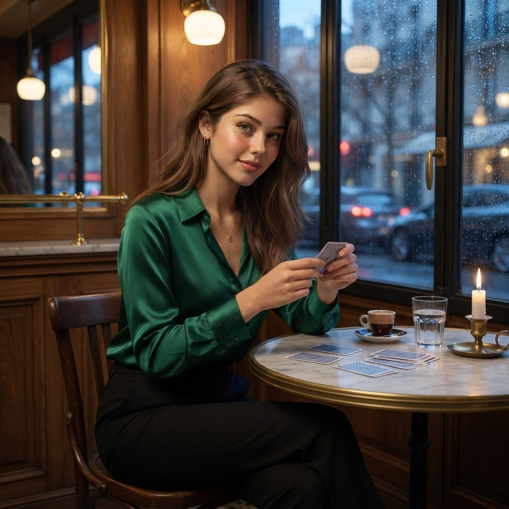

**Model:** Nano Banana Pro · **By:** [@Elvorya](https://x.com/Elvorya) · **Source:** [original post](https://x.com/Elvorya/status/2107835812637450385)

```text
Use the uploaded photo as the ONLY facial identity reference. Preserve her exact facial identity — face shape, bone structure, eyes, eyebrows, nose, lips, jawline, ears, skin tone, natural proportions, and skin texture. Maximum identity consistency with zero facial drift.

Create an ultra-photorealistic cinematic fashion portrait of the same young woman sitting alone at a stylish luxury café, casually playing a game of cards at a small marble table.

She wears a rich emerald-green satin blouse with elegant black tailored trousers, delicate gold jewelry, and sophisticated natural makeup. Her hair falls naturally around her shoulders with realistic individual strands.

Several playing cards are spread across the marble table, while she holds a single card between her fingers with a subtle, confident smile. A small espresso cup, vintage glass, and soft candlelight add atmosphere.

The café features warm wooden interiors, brass details, large rain-covered windows, soft pendant lights, and blurred city lights outside. The mood is mysterious, elegant, intimate, and effortlessly fashionable.

Pose: relaxed and natural, seated comfortably, one hand holding a playing card, the other resting lightly on the table, looking toward the camera.

Camera: medium-full portrait, 50mm lens, cinematic depth of field, natural perspective, realistic hands and fingers, sharp facial details.

Lighting: warm golden café lighting mixed with cool blue window light, soft highlights on her face, realistic shadows and reflections.

Style: luxury fashion editorial, cinematic photography, sophisticated café atmosphere, photorealistic skin, realistic fabric texture, premium magazine aesthetic.

Negative prompt: different face, identity drift, altered facial features, plastic skin, over-retouched face, CGI, cartoon, doll-like appearance, extra fingers, malformed hands, duplicated cards, distorted anatomy, blurry face, unrealistic lighting, text, logo, watermark.
```

[▶ Make it with your photo](https://veida.ai/prompts/pictures-of-yourself?utm_source=github&utm_medium=readme&utm_campaign=awesome-chatgpt-pictures-of-yourself-prompts)

---

## Aesthetic Photoshoots

### 5. Fairy-core dress in a windblown meadow

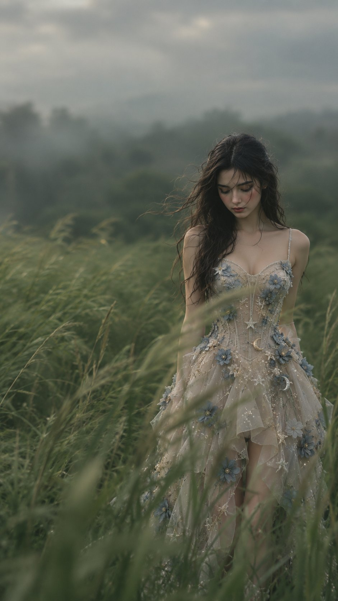

**Model:** ChatGPT · **By:** [@LettyVesper](https://x.com/LettyVesper) · **Source:** [original post](https://x.com/LettyVesper/status/2107752628608467265)

```text
A cinematic editorial portrait showing the subject (see the uploaded photo) standing and partially obscured in the middle of the tall green grass and blown by the wind in the vast meadow. Wearing a champagne/beige fairy-core corset mini dress.

The top is sweetheart neckline + thin spaghetti strap, the waist is pressed, the bottom is a tulle skirt with a high-low ruffle model.

Full sheer tulle material with 3D flower embroidery in dusty blue, stars, and crescent moon + pearl sequins. Dreamy impression, romantic, like a fairy princess dress. Hair like the reference photo looks slightly damp and naturally disheveled by the wind, with a few strands of soft hair falling on their foreheads. Facing forward, the subject looked down a little with a calm, introspective, and melancholy expression. The tall grass surrounds and partially hides their bodies, creating a strong visual depth in the foreground. Soft and cloudy natural lighting; muted sage color palette and deep forest green; alluring and dreamy atmosphere; light mist; smooth blur movement on the grass from the wind; shallow depth of field; smooth and gentle bokeh; smooth film grain texture; low contrast; soft highlights; realistic skin texture; poetic fashion editorial photography; and minimalist composition. Subjects are positioned slightly out of the center to the right, with enough negative space above and around them. Taken with a telephoto portrait lens (about 85mm, f/1.8), producing cinematic compression, high detail, and photorealistic quality; elegant Hollywood fashion magazine aesthetic; calm but lonely mood; vertical poster composition; aspect ratio 9:16.
```

[▶ Make it with your photo](https://veida.ai/prompts/pictures-of-yourself?utm_source=github&utm_medium=readme&utm_campaign=awesome-chatgpt-pictures-of-yourself-prompts)

---

### 6. Three-frame park photoshoot collage

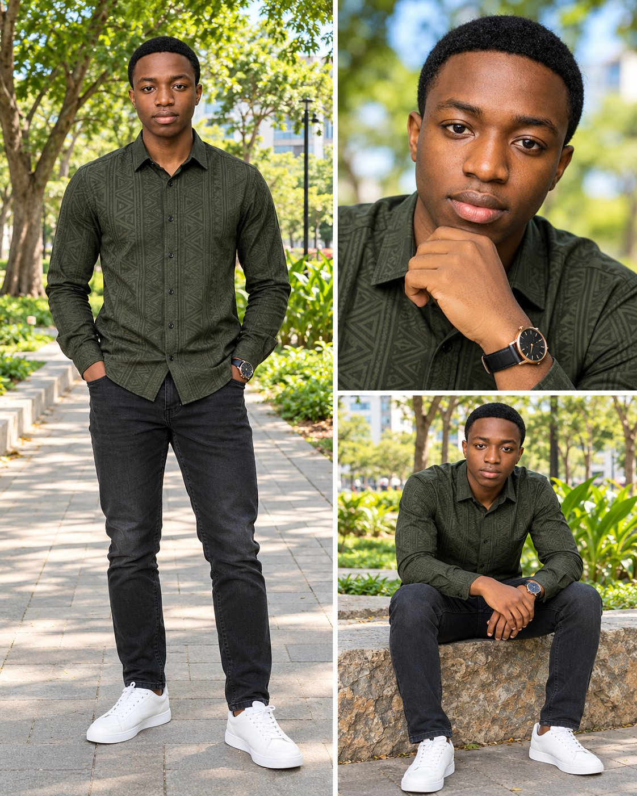

**Model:** GPT Image 2.5 · **By:** [@abs_uiux](https://x.com/abs_uiux) · **Source:** [original post](https://x.com/abs_uiux/status/2107360245873803400)

```text
Use the uploaded photo as the facial identity reference.

Create a premium outdoor lifestyle fashion photography collage featuring the same handsome young adult Black man consistently across all three photographs.

Subject:
A stylish young adult Black man with rich brown skin, a tall slim-athletic build, clean masculine facial features, and a calm confident expression. He has a very clean short low-cut fade haircut with a sharp natural hairline and subtle neatly groomed facial hair. Maintain exactly the same facial identity, hairstyle, skin tone, outfit, and body proportions throughout all three images.

Outfit:
Dress him in a fitted dark olive-green long-sleeve button-up shirt featuring elegant tonal African-inspired geometric patterns woven across the fabric. The shirt has a structured collar, black buttons, and a tailored fit. Pair it with fitted charcoal-black denim jeans and spotless minimalist white low-top leather sneakers. Add a sophisticated black leather-strap wristwatch with a round dark dial and thin metallic case.

Location:
A beautiful green urban park on a bright sunny day. Surround him with lush leafy trees, vibrant green grass, a paved pedestrian walkway, landscaped plants, stone seating, and subtle modern buildings visible through the trees. The background should feel peaceful, clean, upscale, and naturally vibrant.

Create a vertical three-photo collage with thin clean white dividers:

LEFT — Full-body portrait:
The largest image occupies the entire left side. Show the man standing naturally on a paved park walkway, facing directly toward the camera. Both hands are casually placed inside his trouser pockets. His shoulders are relaxed and his feet are slightly apart. Capture his complete body from head to shoes. Trees form a lush natural canopy behind him.

TOP RIGHT — Close-up portrait:
Create a tight chest-up portrait. He looks directly into the camera with a calm expression while resting his chin gently on one hand. Clearly show the wristwatch. Use shallow depth of field so the green leaves and patches of blue sky become soft circular bokeh behind him. Keep his eyes and facial details extremely sharp.

BOTTOM RIGHT — Seated portrait:
Show him sitting casually on a low textured stone wall in the same park. His legs are comfortably apart, feet planted naturally on the pavement, and his forearms rest loosely near his knees with his hands relaxed together. He looks directly toward the camera with quiet confidence.

Photography & Lighting:
Bright natural daylight filtered through tree leaves, flattering soft illumination on the face, realistic warm brown skin tones, subtle natural shadows, crisp clothing texture, vibrant but realistic greenery, high dynamic range, professional DSLR photography, 50mm character for the full-body and seated photographs, 85mm portrait-lens character for the close-up, natural background separation, realistic depth of field, tack-sharp facial details, realistic hands, accurate anatomy, premium fashion editorial quality.

Composition:
Vertical 4:5 collage. Approximately 50% of the layout is occupied by the large full-body photograph on the left. The right half is divided horizontally into a close-up portrait on top and seated portrait below. Use narrow, perfectly straight white borders separating all three photographs.

Quality:
Photorealistic, ultra-detailed, natural skin texture, realistic fabric stitching and geometric patterns, clean footwear, realistic watch details, consistent identity across every frame, professional color grading, polished outdoor men's fashion campaign, high-end social-media photography.

Avoid:
Different faces between panels, hairstyle changes, inconsistent clothing, extra fingers, distorted hands, warped shoes, artificial skin smoothing, exaggerated muscles, oversaturated skin, duplicated accessories, blurry face, text, logos, or watermarks.
```

[▶ Make it with your photo](https://veida.ai/prompts/pictures-of-yourself?utm_source=github&utm_medium=readme&utm_campaign=awesome-chatgpt-pictures-of-yourself-prompts)

---

### 7. Standing beside a mural of your own face

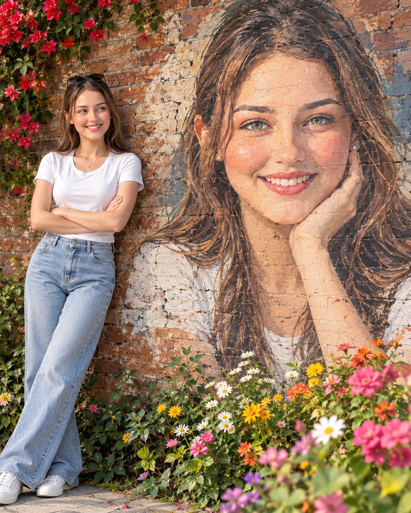

**Model:** GPT Image 2 · **By:** [@AizaAi12](https://x.com/AizaAi12) · **Source:** [original post](https://x.com/AizaAi12/status/2107654976856342754)

```text
Use the uploaded photo as the strict identity reference for both the real woman and the mural. Preserve her exact face, skin tone, natural texture, hairstyle, hair color, and identity with no facial changes or beautification.
Create a 4:5 vertical, ultra-realistic 8K street-art portrait. The woman stands on the left, casually leaning against an old red-brown brick wall, arms crossed and one leg slightly crossed. She wears a fitted white T-shirt, high-waisted light-blue wide-leg jeans, white sneakers, sunglasses on her head, hoop earrings, a delicate necklace, and bracelet.
On the right, create a huge hand-painted mural of the same woman, smiling gently with one hand touching her cheek. The mural must look painted directly onto the brick, with visible brush strokes, cracks, weathering, and brick texture.
Add colorful flowers and green foliage around the wall, especially red flowers above and mixed flowers in the foreground. Use soft natural daylight, warm fresh colors, realistic skin and hair, cinematic lifestyle photography, authentic textures, and a clean editorial look.
Negative: blurry image, identity change, face morphing, wrong facial features, plastic skin, altered hair, distorted hands/fingers/body, fake mural, messy composition, harsh lighting, text, logo, or watermark.
```

[▶ Make it with your photo](https://veida.ai/prompts/pictures-of-yourself?utm_source=github&utm_medium=readme&utm_campaign=awesome-chatgpt-pictures-of-yourself-prompts)

---

### 8. Double-exposure portrait with a soft close-up behind

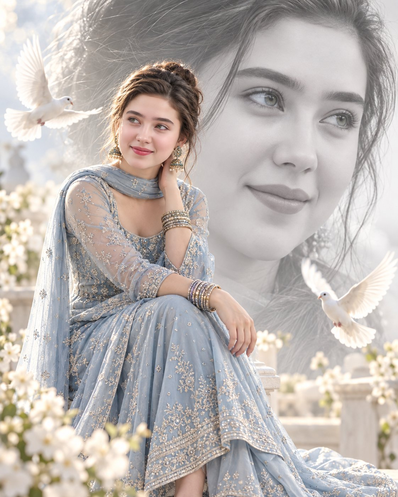

**Model:** ChatGPT · **By:** [@HaniaAi12](https://x.com/HaniaAi12) · **Source:** [original post](https://x.com/HaniaAi12/status/2102226950597009428)

```text
Generate a double-exposure portrait composition featuring the uploaded beautiful woman. In the foreground a full-color, full body of the woman sitting gracefully on a low white stool at bottom and leaning slightly forward, one hand on her lap, other is near her neck, gazing warmly to the left, soft natural smile. She is wearing an elegant pastel blue embroidered ethnic suit (anarkali/lehenga style) with sheer sleeves, delicate beadwork, matching sheer dupatta around neck, traditional metallic bangles stacked on both wrists, and ornate jhumka earrings. Her hair is styled in a soft messy updo with loose strands framing her face. Two white pigeon is flying before her. In the background a blended, large, faded monochrome extreme close-up portrait of the same woman looking in the same direction, seamlessly layered behind the foreground figure. The background has a dreamy, high-key bright lighting effect with soft bokeh. Studio glamour photography, seamless double-exposure edit, soft diffused natural daylight, delicate pastel tones, cinematic shallow depth of field, high resolution, 8k portrait photography. Maintain the face exactly the same as the uploaded photo. Aspect ratio 4:5
```

[▶ Make it with your photo](https://veida.ai/prompts/pictures-of-yourself?utm_source=github&utm_medium=readme&utm_campaign=awesome-chatgpt-pictures-of-yourself-prompts)

---

### 9. Your photo as a botanical ink illustration

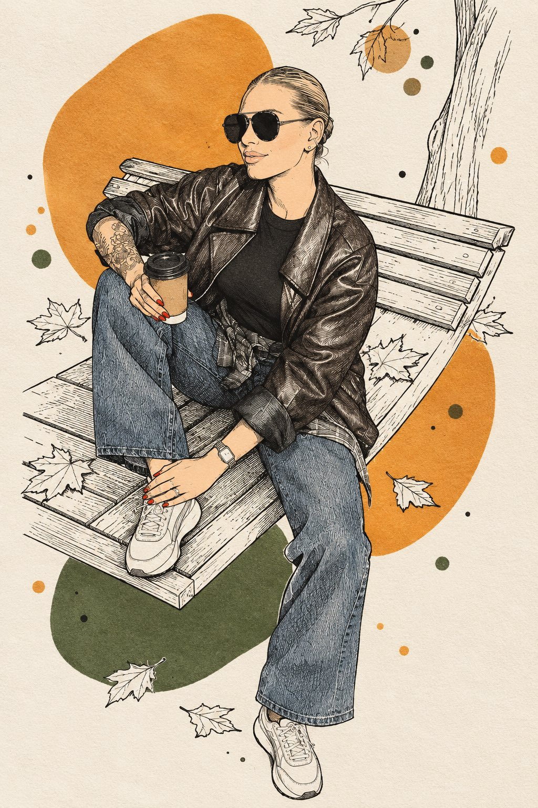

**Model:** GPT Image 2 · **By:** [@Sairah_0](https://x.com/Sairah_0) · **Source:** [original post](https://x.com/Sairah_0/status/2109528116574212097)

```text
PHOTO → BOTANICAL INK & COLOR-BLOCK ILLUSTRATION Transform the uploaded photo into a stylish hand-drawn illustration inspired by botanical ink sketching combined with bold abstract color fields. Redraw the entire image. 100% illustration, 0% photography. PRESERVE THE ORIGINAL: Keep the original composition, main subject, pose, proportions, recognizable facial features if a person is present, hairstyle, clothing silhouette and important objects. Do not change the identity or basic structure of the scene. STYLE: Reinterpret the photo using a striking contrast between: • very fine black ink linework • delicate botanical-style contour drawing • large flat organic color shapes • small scattered color dots and rounded patches • generous untouched warm-white paper The illustration should feel handmade, artistic and slightly imperfect, like a drawing created with a fine black fineliner and broad marker strokes in a spiral sketchbook. LINEWORK: Draw the main subject primarily with thin, elegant black lines. Use flowing contour lines and fine parallel hatching to describe form, shadows, hair, clothing folds and important details. Avoid realistic rendering and smooth digital shading. Some areas should contain intricate black linework while others remain almost completely empty. COLOR PALETTE — CRITICAL: Analyze the uploaded photo and extract its most visually characteristic colors. Choose: • 2 dominant colors from the original image • 1 contrasting or complementary accent color derived naturally from the photo Use ONLY these selected colors together with black ink and warm white paper. Do not copy every color from the photograph. COLOR BLOCKS: Place large irregular organic color fields behind, around and occasionally partially across the subject. The shapes should look loosely hand-painted with broad markers: rounded blobs, imperfect circles, asymmetric patches and softly geometric forms. Do NOT precisely fill objects with color. Instead, allow the color blocks and black drawing to overlap independently, creating an intentional screen-print / sketchbook effect. Add a few much smaller colored dots or patches around the composition to create rhythm and balance. SUBJECT: The subject must remain clearly recognizable from the original photo, but translated completely into this graphic language. If a person is present, preserve recognizable facial proportions and characteristic features through economical black linework rather than realism. Use fewer lines on the face so it stays clean and readable. BACKGROUND: Strongly simplify the original background. Do not reproduce every background detail. Translate only a few important environmental elements into delicate black outlines. Replace most of the background with warm-white negative space and abstract color fields derived from the original photograph. COMPOSITION: Create an airy, asymmetric composition. Let some black contours extend beyond the color blocks. Let some colored shapes disappear behind the subject. Allow occasional color to cross the linework. The result should feel deliberately imperfect rather than digitally precise. PAPER: Warm white, slightly textured heavyweight sketchbook paper. Subtle visible paper grain. FINAL LOOK: modern botanical ink illustration, fine black fineliner, bold marker color blocks, limited photo-derived palette, organic abstract shapes, delicate hatching, lots of negative space, handmade sketchbook aesthetic, graphic but elegant, recognizable original subject. AVOID: photorealism, realistic digital painting, 3D rendering, smooth gradients, watercolor washes, colored outlines, overly detailed backgrounds, full-frame color, perfect geometric shapes, generic floral decorations, random colors unrelated to the uploaded photo, dense detail covering the entire image.
```

[▶ Make it with your photo](https://veida.ai/prompts/pictures-of-yourself?utm_source=github&utm_medium=readme&utm_campaign=awesome-chatgpt-pictures-of-yourself-prompts)

---

## Funny Pictures of Yourself

### 10. Working a giant claw machine full of life goals

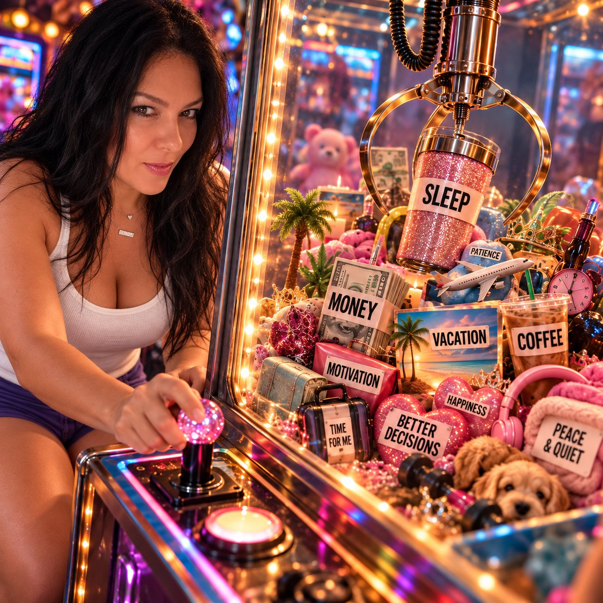

**Model:** not stated · **By:** [@KSJ_Kreative](https://x.com/KSJ_Kreative) · **Source:** [original post](https://x.com/KSJ_Kreative/status/2106943874858115331)

```text
Use my uploaded photo as the identity reference. Keep me recognizable, whether I’m a man or woman.

Create a funny surreal scene where I’m operating a gigantic arcade claw machine—but instead of toys, the machine is filled with tiny versions of things I desperately need in life.

Invent the items based on the vibe of my photo. Make them funny, relatable, and unexpected—things like sleep, money, patience, coffee, motivation, vacation, peace and quiet, or better decisions.

Show me intensely controlling the giant claw as I try to grab ONE item while everything else is just out of reach.

Make the scene colorful, cinematic, highly detailed, playful, and slightly chaotic. Add funny little labels or visual details inside the machine, but keep the text minimal.

Surprise me with what the claw is trying to grab.
```

[▶ Make it with your photo](https://veida.ai/prompts/pictures-of-yourself?utm_source=github&utm_medium=readme&utm_campaign=awesome-chatgpt-pictures-of-yourself-prompts)

---

### 11. Your emotional support animal has issues

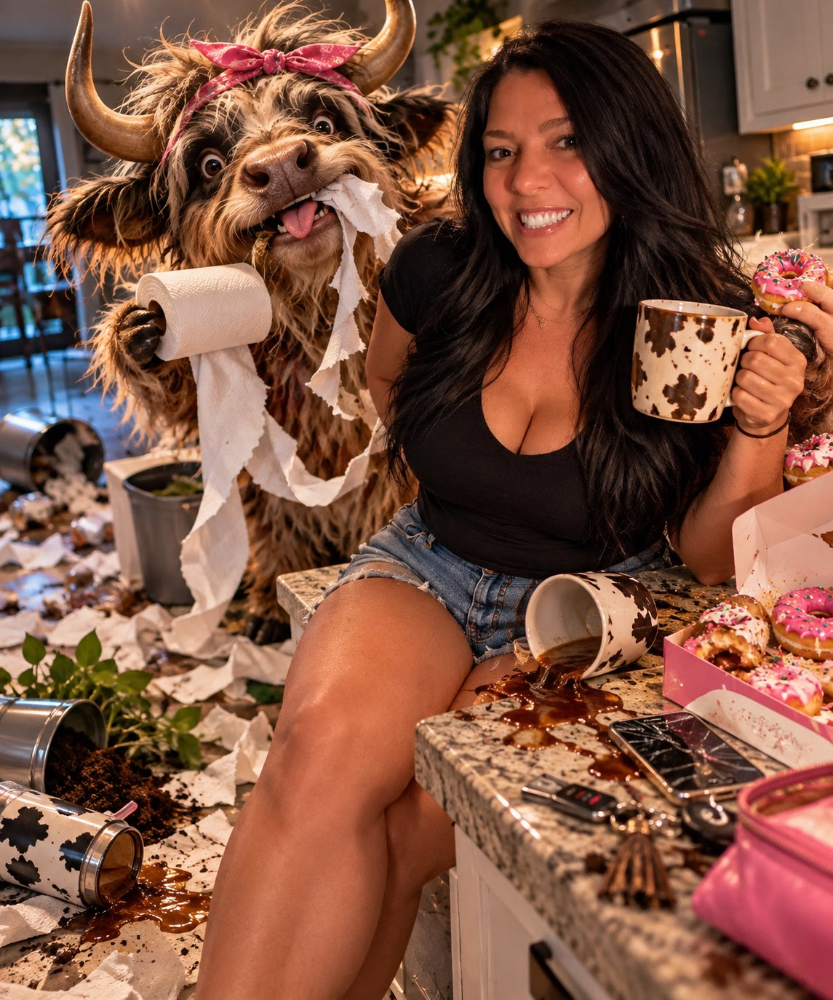

**Model:** not stated · **By:** [@KSJ_Kreative](https://x.com/KSJ_Kreative) · **Source:** [original post](https://x.com/KSJ_Kreative/status/2107495479386771893)

```text
Use my uploaded photo as the strict identity reference and keep me unmistakably recognizable—same face, age, skin tone, hair, body proportions, and overall vibe.

Study my expression, style, and personality from the photo, then invent ONE completely unexpected emotional-support creature that feels hilariously perfect for me. Do not automatically choose a dog, cat, dinosaur, or ordinary pet. It can be mythical, prehistoric, supernatural, absurdly mutated, or something completely made up.

Show us in one cinematic everyday scene doing something completely normal—grocery shopping, getting coffee, pumping gas, working, cooking, running errands, etc.—while my emotional-support creature is creating an absolutely unnecessary level of chaos.

The creature should have a huge personality: dramatic, mischievous, stubborn, spoiled, overprotective, judgmental, destructive, clingy, or completely unhinged. Give it expressive body language and one ridiculous habit that makes the scene even funnier.

Meanwhile, I should look totally calm and unfazed, like dealing with this creature is just another Tuesday.

Make the contrast between my calm energy and the creature’s behavior the entire joke.

Highly detailed, visually impressive, cinematic lighting, believable anatomy, dynamic action, funny background details, realistic interaction between us, and strong storytelling.

Surprise me with the creature and situation. Make it weird enough that nobody else gets the same result.

One scene only. No panels. No duplicate person. No generic model. No distorted face or hands. No random text or watermark.
```

[▶ Make it with your photo](https://veida.ai/prompts/pictures-of-yourself?utm_source=github&utm_medium=readme&utm_campaign=awesome-chatgpt-pictures-of-yourself-prompts)

---

### 12. Photoreal character sheet of yourself

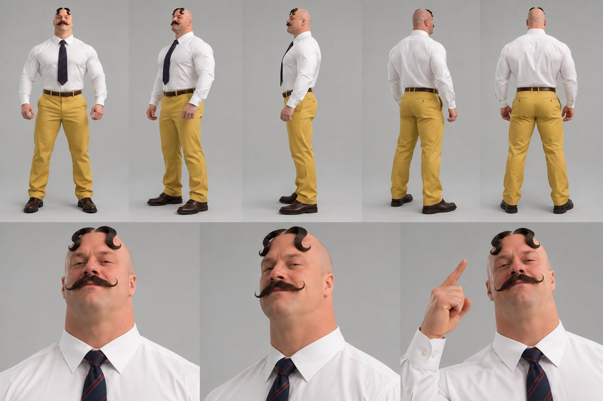

**Model:** ChatGPT · **By:** [@rossark0](https://x.com/rossark0) · **Source:** [original post](https://x.com/rossark0/status/2105744719443824876)

```text
Create a photorealistic character reference sheet of the character in the attached image.

Layout (one landscape image, two rows):
- Top row: 5 full-body shots on a plain light-gray studio background: front, 3/4 left, side profile, 3/4 back, back.
- Bottom row: 3 head-and-shoulders close-ups: neutral front, 3/4 angle, and one expressive shot.

Keep the face, hair, body, outfit and accessories identical in every shot.
Style: realistic photography, soft even studio lighting, sharp focus. No text, no labels, no watermark.
```

[▶ Make it with your photo](https://veida.ai/prompts/pictures-of-yourself?utm_source=github&utm_medium=readme&utm_campaign=awesome-chatgpt-pictures-of-yourself-prompts)

---

## How to use these prompts

1. Pick a clear, evenly lit photo of yourself, face toward the camera.
2. Copy a prompt block, or open the [gallery on Veida](https://veida.ai/prompts/pictures-of-yourself?utm_source=github&utm_medium=readme&utm_campaign=awesome-chatgpt-pictures-of-yourself-prompts) and press *Make it with my photo*.
3. Where a prompt says "she" or "he", change it to match your photo.
4. If a take drifts from your face, reply with "keep the face exactly the same as in the first close-up".

## Contributing

Found a great prompt for pictures of yourself on X, Reddit or elsewhere? Open a pull request with the full prompt, the output image and a link to the original post. Entries without a source link are not accepted.

## Credits & takedown

All prompts and images belong to their original creators and are linked to the source post. If you are a creator and want your entry removed or re-credited, open an issue and it will be handled promptly.
